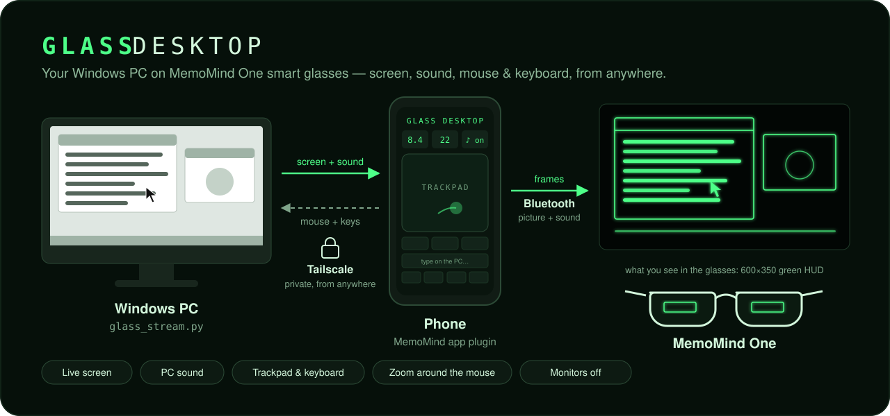

# Glass Desktop



Your Windows PC on **MemoMind One** smart glasses — screen, sound, mouse and
keyboard — from anywhere over Tailscale.

A small Python app on the PC captures the screen, shrinks and dithers it to the
glasses' 600×350 green display and streams it to a MemoMind phone plugin, which
passes each frame to the glasses. The phone doubles as a trackpad and keyboard,
and the PC's sound plays through the glasses' speakers.

```
PC (glass_stream.py) ──Tailscale (wss)──► iPhone/Android (MemoMind app plugin) ──Bluetooth──► glasses
   screen, sound, input                      trackpad, keyboard, settings           HUD + speakers
```

## Features

- **Picture:** live screen at 600×350, 2 or 4 shades, *Text* style (sharp, inverted
  so text glows on a clear background) or *Shaded* style (pictures, video).
  Only changed areas are sent, so a still desktop costs almost nothing.
- **Zoom around the mouse** (1×–6×), cycled with the glasses button.
- **Sound:** whatever the PC plays, filtered and buffered for clean playback.
- **Trackpad & keyboard on the phone:** move, tap/two-finger tap to click, two-finger
  scroll, hold to drag, iPhone keyboard typing and shortcut keys.
- **One-screen mode:** while connected, only the screen you pick stays on; it can
  drop to a lower resolution (e.g. 1280×720) so text is bigger on the glasses.
- **Monitors off:** the physical monitors power down (DDC/CI) while you stream;
  everything comes back exactly as it was when you disconnect.
- **Autostart:** runs hidden at Windows sign-in, no terminal needed.

## Requirements

- Windows 10/11 PC with Python 3.10+ (tested with 3.15)
- [Tailscale](https://tailscale.com) on the PC and the phone, with *Serve* and
  *HTTPS certificates* enabled for your tailnet
- MemoMind One glasses and the MemoMind app
- MemoMind's [plugin-open-platform](https://github.com/memomind-open/plugin-open-platform)
  (for Studio and the Web SDK)

## Setup

Clone this repo **inside** your `plugin-open-platform` folder, so Studio finds the plugin:

```powershell
cd $HOME\plugin-open-platform
git clone https://github.com/ZoneDK-sudo/glass-desktop.git
```

### 1. PC

```powershell
cd $HOME\plugin-open-platform\glass-desktop\pc
py -m pip install -r requirements.txt
tailscale serve --bg 8765          # once; Tailscale remembers it
py glass_stream.py --one-screen --no-pin
```

It prints your screens, `PC audio: on`, and (without `--no-pin`) a PIN for the phone.
The phone connects to your PC's Tailscale name, e.g. `mypc.tail1234.ts.net`.

### 2. Phone plugin

```powershell
powershell -ExecutionPolicy Bypass -File $HOME\plugin-open-platform\glass-desktop\plugin\get-sdk.ps1
```

This copies MemoMind's Web SDK into `plugin/glass-desktop/vendor/` (it isn't
included in this repo). Then in **MemoMind Plugin Studio**: *Import workspace* →
select `plugin-open-platform` → pick **Glass Desktop** → send it to your phone.

### 3. Connect

Open Glass Desktop on the phone, enter the PC's `…ts.net` name (and PIN if used),
tap **Connect**, and pick the screen to show.

### 4. Start automatically (optional)

```powershell
py glass_stream.py --install-autostart --one-screen --no-pin
```

Runs hidden at every sign-in; output goes to `pc/glass_stream.log`.

| Command | What it does |
| --- | --- |
| `--stop` | stop the background copy (restores screens if needed) |
| `--uninstall-autostart` | remove autostart |
| `--restore-screens` | put the screens back if anything was interrupted |

## PC options

| Option | Meaning |
| --- | --- |
| `--one-screen` | only the picked screen stays on while connected |
| `--res 1280x720` | default resolution for that screen while streaming (the app can change it) |
| `--screens-off` | default to switching the monitors off while streaming (the app can change it) |
| `--no-pin` | don't require a PIN (only devices on your tailnet can reach the PC anyway) |
| `--no-audio` | don't send the PC's sound |
| `--monitor N` | default screen by number at start-up (the app's picker is more reliable) |
| `--max-fps 20` | capture rate cap |
| `--no-sharpen` | turn off edge sharpening |
| `--port 8765` | local port (match it in `tailscale serve`) |

## Phone controls

- **Glasses button:** press = cycle zoom, hold = pause/resume
- **Trackpad:** 1 finger move · tap = click · 2-finger tap = right-click ·
  2 fingers = scroll · press-and-hold then move = drag
- **Keys:** Esc, Tab, ⌫, Enter, arrows, Win, Alt+Tab, Copy, Paste, Undo, All, Desktop, Close

## Troubleshooting

- **No sound:** check `PC audio:` in the log; `py -m pip install soundcard`.
- **"Port 8765 is busy":** the background copy is running — `py glass_stream.py --stop`.
- **Screens stayed off / wrong layout:** `py glass_stream.py --restore-screens` or Win+P → Extend.
- **A monitor won't switch off:** enable *DDC/CI* in that monitor's own menu.
- **Phone can't connect:** Tailscale on on both devices, `tailscale serve status`
  shows `proxy http://127.0.0.1:8765`, and use the name without `https://`.
- **Can't control an admin window:** Windows blocks input into elevated apps unless
  the script also runs as administrator.

## How it works

- **Frames:** screen → grey → tone curve (+ auto-invert) → ordered dither or text
  quantising → packed GRAY_4 → only the changed rectangle → LZ4 → WebSocket
  (`GD` v2 messages). The phone forwards each rectangle with the Scene Bridge
  (`display.updateImageLz4`, atomic multi-tile frames) and acks; the PC always
  sends the newest capture, so there is never a backlog.
- **Sound:** WASAPI loopback → 48→24 kHz with an anti-alias filter → 16-bit PCM
  (`GA` messages) → one continuous Web Audio ring buffer on the phone with gentle
  clock-drift correction.
- **Input:** JSON messages → Windows `SendInput`.
- **Screens:** `ChangeDisplaySettingsEx` (layout and resolution, saved to
  `screens_backup.json` first) and DDC/CI VCP 0xD6 (monitor power).

## Security

The streamer listens only on `127.0.0.1`; `tailscale serve` exposes it to devices
on your tailnet only. Anyone who can connect can see the screen and use the mouse
and keyboard, so keep the PIN on if your tailnet includes devices or people you
don't fully trust. Never use `tailscale funnel` with this.

## License

MIT — see [LICENSE](LICENSE). MemoMind's SDK is not included and is covered by the
[MemoMind Open Platform terms](https://open-platform.memo-mind.com/terms).
